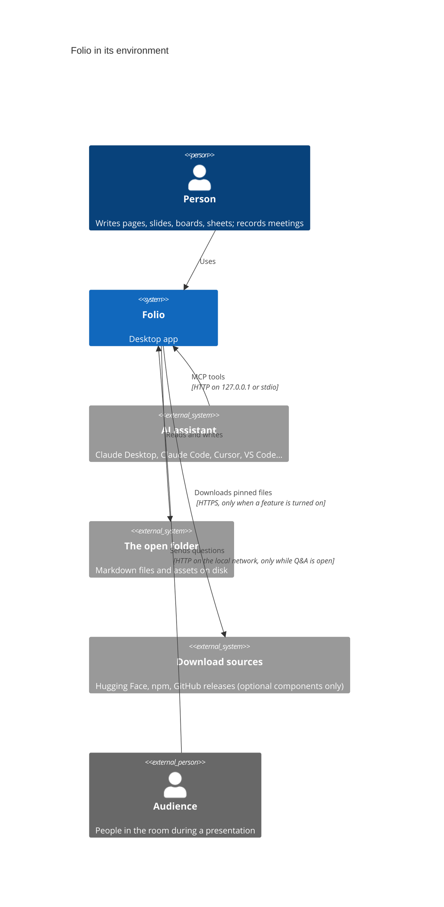
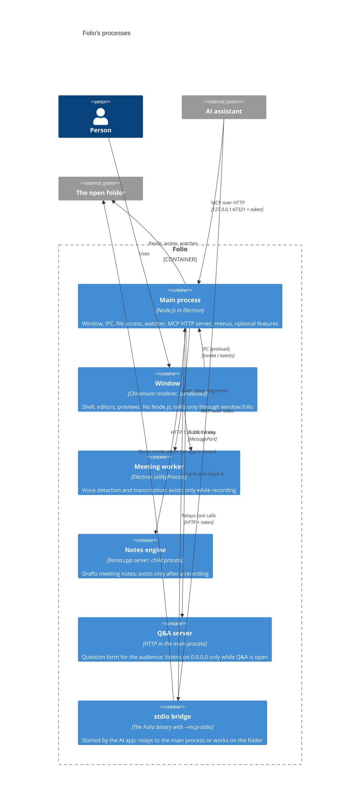
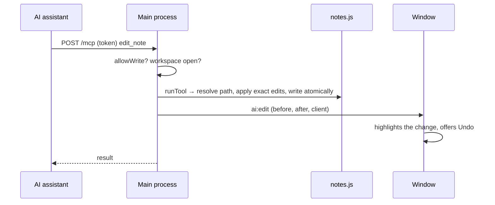

# Folio architecture

This document follows the [arc42](https://arc42.org) template (12 sections) and draws its diagrams with the
[C4 model](https://c4model.com) in Mermaid, so they render on GitHub and in Folio itself. Decisions are recorded one per
file in [`docs/adr/`](../adr/README.md); this page links to them instead of repeating them.

## 1. Introduction and goals

Folio is a desktop app (Windows, macOS) for documents that people and AI assistants edit together. Everything the person
creates is a Markdown file in a folder they choose: pages, slide decks, whiteboards and sheets.

| Priority | Quality goal | What it means here |
|---|---|---|
| 1 | **The person's files are safe** | Opening a file never rewrites it; a crash never leaves a half-written file; nothing outside the open folder is touched. |
| 2 | **Responsive** | No hang (≥ 250 ms blocked) in common actions; under 100 ms of main-thread work per interaction ([budget](../performance/budget.md)). |
| 3 | **Lean** | Small installer, little memory at rest, optional features cost nothing until turned on. |
| 4 | **Open to AI assistants, safely** | AI tools act through MCP on the open folder only, every change is visible and undoable. |
| 5 | **Files stay portable** | Plain Markdown that other editors read; no lock-in, no database. |

Stakeholders: the person using Folio (often non-technical), AI assistants connected through MCP, contributors (the AGPL
requires anyone who distributes or serves a modified version to publish its source; changes come back through pull
requests, see `CONTRIBUTING.md`).

## 2. Constraints

- Electron, one code base for Windows and macOS ([ADR 0001](../adr/0001-electron.md)).
- Files are Markdown on disk; Folio adds no database ([ADR 0002](../adr/0002-markdown-files-are-the-model.md)).
- License AGPL-3.0 with an attribution term (NOTICE); every bundled or downloaded part must be compatible.
- Design rules in `AGENTS.md`: tokens only, grey palette, visible focus, reduced motion respected.

## 3. Context and scope

Outside Folio's scope: sync (use any sync client on the folder), accounts, a cloud service. Folio sends nothing to a
server; the only network traffic is the optional component download and what the person's documents link to.

## 4. Solution strategy

| Goal | Approach |
|---|---|
| Files safe | One module resolves every path (`notes.js`); atomic writes ([ADR 0008](../adr/0008-atomic-writes.md)); lossless round-trip tests for every format. |
| Responsive | Note reading, writing and network calls are asynchronous in the main process (the few small synchronous calls are listed in [process-model](../explanation/process-model.md)); heavy work in other processes; visual editors loaded on first use ([ADR 0009](../adr/0009-lazy-visual-editors.md)). |
| Lean | The installer carries only the esbuild bundle ([ADR 0010](../adr/0010-ship-the-bundle-only.md)); optional components are downloaded on demand ([ADR 0005](../adr/0005-optional-components-are-downloaded.md)). |
| AI, safely | One tool table for both MCP hosts, token and Host/Origin checks, read-only switch ([ADR 0004](../adr/0004-mcp-over-http-and-stdio.md)). |
| Portable | Each document type is a Markdown dialect with a pure parser and serializer ([`FORMATS.md`](../FORMATS.md)). |

## 5. Building block view

### Level 1: containers (processes)

### Level 2: modules

| Area | Modules | Responsibility |
|---|---|---|
| Entry | `src/main/boot.js` | One binary, two jobs: the app, or the stdio bridge (`--mcp-stdio`). |
| Composition root | `src/main/main.js` | Settings, window, IPC handlers (`h()`), watcher, MCP HTTP server, menu, lifecycle. Wires the modules below. |
| Files | `src/main/notes.js`, `src/main/atomic.js` | Every path is resolved and checked here; tree, search, backlinks, trash; atomic writes. |
| AI tools | `src/main/mcp-tools.js`, `src/main/mcp-slides.js`, `src/mcp/stdio.js` | The MCP tool table, shared by the HTTP server and the bridge ([reference](../reference/mcp-tools.md)). |
| Safety helpers | `src/main/permissions.js`, `src/main/netguard.js` | Browser permissions; public-address checks for exports. |
| Optional features | `src/main/features/` (catalog, installer, unpack), `src/main/meeting/` (service, worker, transcript, notes) | Pinned downloads; the meeting recorder ([explanation](../explanation/meeting-recorder.md)). |
| Bridge | `src/main/preload.cjs` | The only API the window has: `window.folio` ([reference](../reference/ipc.md)). |
| Shell | `src/renderer/app.js` | Tabs, tree, views, palette, settings, AI edit banner and undo, export. |
| Pages | `rich.js` (TipTap), `editor.js` (CodeMirror), `markdown.js` (preview) | Visual and code editing of `.md`. |
| Slides | `slides-core.js` (pure) + `slides*.js` (surface, present, import/export) | `name.slides.md`. |
| Boards | `board-core.js` (pure) + `board.js` | `name.board.md`. |
| Sheets | `sheet-core.js` (pure parser) + `src/sheets/` (Univer surface, panels, data engine process) | `name.sheet.md` ([Folio Sheets](../sheets/README.md)). |
| References | `refs-syntax.js` (pure), `refs.js` | `[[Doc#part]]`, `{{Doc#part}}`, embeds across documents. |

Rule: a **core** (`*-core.js`, `refs-syntax.js`, `notes-core.js`, `transcript.js`, `catalog.js`) is pure, has no DOM or
Electron, and is tested in Node. A **surface** draws and edits it in the window.

## 6. Runtime view

**Opening and saving a page.** The window asks `fs:read` → `notes.resolve()` checks the path → text goes to CodeMirror and
TipTap. Typing updates the tab; saving sends `fs:write`, the main process records the text in `ownWrites` (so the watcher
ignores its own change) and writes atomically. An outside change (another editor, sync, an AI) reaches the window as
`fs:file-changed`.

**An AI edits a note.**

**A meeting recording.** Start → the worker loads the speech model → the window captures the microphone and the computer's
sound into an AudioWorklet → 100 ms blocks go on a MessagePort to the worker → segments come back and are appended to a
work file → Stop → the transcript is written to `Meetings/` → the worker exits → if installed, the notes engine starts,
drafts notes, the code checks every quote, the note is updated, the engine exits.

## 7. Deployment view

- Packaged with electron-builder: NSIS installer and a portable exe (Windows), DMG and ZIP (macOS). The asar holds
  `dist/` only (≈ 14 MB). Electron fuses (`build/afterPack.cjs`): only load the app from the asar, no `NODE_OPTIONS`, no
  inspector flags; `RunAsNode` off on macOS and Linux.
- User data: `settings.json` (owner-only, holds the MCP token) and `mcp-bridge.json` in Electron's userData folder.
- Optional components: `%LOCALAPPDATA%\Folio\components` (Windows), `~/Library/Application Support/Folio/components`
  (macOS); never in a roaming or synced folder.
- Releases: CI builds on a `v*` tag and publishes to GitHub Releases ([how-to](../how-to/release.md)).

## 8. Cross-cutting concepts

- **Security**: see [`SECURITY.md`](../../SECURITY.md) and [explanation](../explanation/security.md). Workspace boundary, sandboxed window, strict CSP, local MCP server with token.
- **Data safety**: lossless round-trip, atomic writes, trash instead of delete, undo for AI edits ([explanation](../explanation/data-safety.md)).
- **Performance**: budgets and how they are measured ([budget](../performance/budget.md), [how-to](../how-to/measure-performance.md)).
- **Errors**: IPC handlers throw plain-language messages that the window shows as toasts; a crashed window is reloaded.
- **Design system**: `src/renderer/tokens.css` and the rules in `AGENTS.md`.
- **Accessibility**: ARIA roles on menus and switches, visible focus, reduced motion, no meaning by colour alone.

## 9. Architecture decisions

See [`docs/adr/`](../adr/README.md).

## 10. Quality requirements

| Scenario | Measure |
|---|---|
| A person types in a 400-section page | Longest task per keystroke < 100 ms (measured 50–57 ms) |
| Folio starts with 1,500 notes | Page loaded in < 1 s (measured 0.5 s); no task ≥ 250 ms |
| Power is cut while saving | The file has the old or the new text (atomic write test) |
| An AI asks for `../../.ssh/id_rsa` | Refused by `notes.resolve()` (security tests) |
| A meeting of 60 minutes | Worker ≤ 3 GB, app ≤ 4 GB; transcript saved even if the notes fail |

## 11. Risks and technical debt

- `main.js` is the composition root and also holds the MCP HTTP server and the AI-app connection code; splitting them
  into modules is planned when they next change, not as a refactor of its own.
- The meeting recorder is not yet measured on Windows hardware (loopback with USB and Bluetooth headsets, Defender).
- The audience Q&A page listens on all network interfaces while it is open, so anyone on the same network can send a
  question. It accepts only short text, keeps it in memory and serves no files; it closes when the presenter closes Q&A.
- Windows keeps the `RunAsNode` fuse on for the stdio bridge.
- Builds are not code-signed yet.

## 12. Glossary

| Term | Meaning |
|---|---|
| Workspace, folder | The folder open in Folio; the boundary for every file operation. |
| Page, deck, board, sheet | `.md`, `.slides.md`, `.board.md`, `.sheet.md`. |
| Core / surface | Pure model of a document type / its editor in the window. |
| MCP | Model Context Protocol, how AI assistants call Folio's tools. |
| Bridge | The Folio binary run with `--mcp-stdio` by an AI app. |
| Component | A file set an optional feature downloads (`catalog.js`). |
| Worker | The meeting transcription process. |
