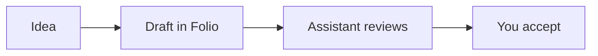

# Product roadmap

The plan for the next two quarters. Each item links to its own note, like [[Onboarding]] or [[Pricing ideas]]. Edited.

> [!NOTE]
> Dates move. The order of the work matters more than the dates.

## Now

- [x] Ship the Markdown editor
- [x] Connect assistants through MCP
- [ ] Review AI edits line by line
- [ ] Publish the first build for Windows and macOS

## Next

| Item                | Owner | Why it matters                    |
| ------------------- | ----- | --------------------------------- |
| Sync across devices | Open  | People write on two machines      |
| Templates           | Open  | Faster starts for recurring notes |

## Budget at a glance

```chart
type: line
title: Spend per quarter
source: Budget.sheet.md
sheet: Costs
range: A1:G5
by: rows
```

## How a change flows



## Notes on the editor

The editor keeps `plain text` on disk, so any tool can read it. Inline maths works too: $E = mc^2$.

```js
export function wordCount(text) {
  return (text.match(/\S+/g) || []).length;
}
```

## Linked results

Total budget: {{Budget.sheet#Costs!H6}}, status {{Budget.sheet#Costs!H7}}. The deck opens with {{Pitch.slides#1}}.

![[Budget.sheet#Costs!A1:H5]]

![[System.board]]

![[Pitch.slides#2]]
